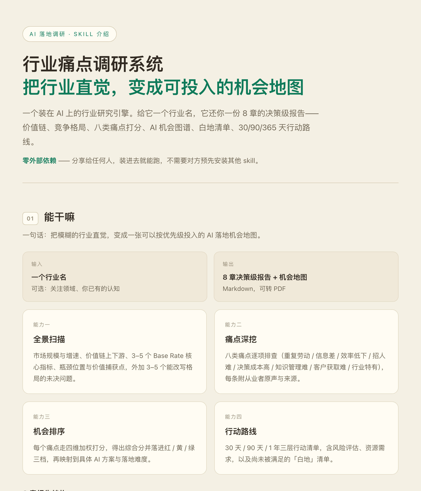

# 行业痛点调研系统 · Industry Painpoint Research


> **一句话**：把模糊的行业直觉，变成一张可以按优先级投入的 AI 落地机会地图。
>
> **English**: Give an AI agent an industry name; get back a prioritized AI opportunity map — sourced claims, scored pain points, and a 30/90/365-day action roadmap.
>
> 📄 **[English version → README_EN.md](./README_EN.md)**

它不是「让 AI 帮你搜行业资料」。前者产出的是资料，后者产出的是**先做哪个**。

<p align="center">
  
</p>
<p align="center"><sub>👆 完整介绍长图（1800×12731）见 <a href="docs/preview-full.jpg">docs/preview-full.jpg</a></sub></p>

---

## 目录

- [30 秒了解](#30-秒了解)
- [为什么需要它](#为什么需要它)
- [效果对照](#效果对照)
- [快速开始](#快速开始)
- [使用示例](#使用示例)
- [输出结构](#输出结构)
- [工作原理](#工作原理)
- [目录结构](#目录结构)
- [设计原则](#设计原则)
- [什么时候不该用它](#什么时候不该用它)
- [已知局限](#已知局限)
- [FAQ](#faq)
- [贡献](#贡献)
- [许可](#许可)

---

## 30 秒了解

| | |
|---|---|
| **输入** | 一个行业名（可选：关注领域、你已有的认知） |
| **输出** | 8 章决策级研究报告（Markdown，可转 PDF） |
| **耗时** | 3–40 分钟，三档可选 |
| **外部依赖** | **无**。装进去就能跑 |
| **需要联网** | 是。子代理依赖 WebSearch / WebFetch 取证 |

**四个核心能力**

1. **全景扫描** — 市场规模、价值链、Base Rate 核心指标、瓶颈位置与价值捕获点
2. **痛点深挖** — 八类痛点逐项排查，每条附从业者原声与来源
3. **机会排序** — 四维加权打分 → 红 / 黄 / 绿三档 → 映射到具体 AI 方案
4. **行动路线** — 30 / 90 / 365 天清单 + 风险评估 + 尚未被满足的「白地」

---

## 为什么需要它

直接让 AI 做行业调研，通常会得到四种东西——而且**前两种看起来完全正常**：

| 失败模式 | 为什么危险 |
|---|---|
| **看起来很像真的数字** | 有数字、有结论、格式漂亮，但没有来源。它不报错，只是悄悄错。 |
| **正确的废话** | 「数字化转型是大势所趋」。因为没给清单、让模型自由发挥，它只能输出最大公约数。 |
| **看不出 AI 能干什么** | 资料一大堆，落点一个没有。读了等于没读。 |
| **换个行业就失效** | 冷门行业搜不到东西，模型就开始编。**越是你不熟的行业，编得越像真的。** |

这套系统不为「让 AI 写得更好」，而是**用机制把这四个失败路径逐一堵死**（见[设计原则](#设计原则)）。

---

## 效果对照

| 维度 | 直接让 AI 调研 | 用这套系统 |
|---|---|---|
| 输出形态 | 资料汇编，读完不知道该干什么 | 排序后的机会清单 + 行动路线 |
| 数字可信度 | 有数字没来源，一追问就塌 | 每个断言挂来源；单一来源强制标「未验证」 |
| 冷门行业 | 搜不到就开始编 | 明说「数据不足」，退到最小可行报告 |
| 落点 | 「AI 将深刻改变行业」 | 八类痛点逐项打分，落到「先做哪个」 |
| 视角 | 单一上下文，偏见自己跟自己印证 | 4 个子代理并行取证，最后才合成 |
| 可复现 | 每次从头聊，结构随机漂移 | 骨架写死在模板里，结果稳定 |
| 依赖 | 换个环境就变形 | 零外部依赖 |

---

## 快速开始

### 1. 安装

```bash
git clone https://github.com/robertjim66/industry-painpoint-research.git
cp -r industry-painpoint-research ~/.workbuddy/skills/
```

> 其他平台的 skills 目录：`~/.claude/skills/`（Claude Code）、`~/.codex/skills/`（Codex）。
> 本 skill 只用到 WebSearch / WebFetch，不依赖任何平台私有能力。

### 2. 一句话启动

```
研究一下 XX 行业的 AI 落地机会
```

```
帮我找 XX 行业的痛点
```

### 3. 回答三个问题

它会先跟你确认：

1. **研究深度档位** — 快速扫描 / 标准研究 / 深度尽调
2. **关注领域** — 全行业，还是只看某几个环节
3. **你已有的认知** — 有认知就别让它从零跑

### 三档深度

| 档位 | 适用场景 | 子代理数 | 产出 | 耗时 |
|---|---|---|---|---|
| 🚀 快速扫描 | 初步判断值不值得深入 | 2 个 | 执行摘要 + 痛点矩阵精简版（800–1500 字） | 3–5 分钟 |
| 🔍 标准研究 | 常规决策支撑 | 4 个 | 8 章简版 | 8–15 分钟 |
| 🏗️ 深度尽调 | 投资 / 战略决策 | 4 个 + 额外验证 | 8 章 + 附录 + 数据表 | 20–40 分钟 |

---

## 使用示例

> 📁 [`examples/`](./examples/) 下有 4 份完整样例：5 组可复制的启动提示词、快速扫描档输出、标准研究档 8 章输出，以及**降级时的「最小可行报告」**。
> ⚠️ 输出样例均为结构示意，非真实调研结果，请勿引用。

**输入**

```
研究一下「第三方医学检验」行业的 AI 落地机会，深度：标准研究
```

**输出片段（结构示意，非真实调研结果）**

<details>
<summary>展开查看</summary>

```markdown
## 4. 痛点矩阵（节选）

### 痛点 3 · 效率低下  🔴 高优（综合 4.05）

- **识别信号**：样本分拣依赖人工、报告出具周期 3–5 天、跨院数据不通
- **从业者原声**：
  > "高峰期一天两千管，分拣全靠人头记，错一管就得重采。"
  > —— 某垂直社区从业者帖（来源链接）
- **四维评分**：

| 维度 | 评分 | 依据 |
|---|---|---|
| 普遍性 | 5 | 头部与区域实验室均存在 |
| 严重度 | 4 | 直接决定报告周期与客户留存 |
| 付费意愿 | 4 | 已有实验室采购自动化分拣产线 |
| AI 适配度 | 3 | 视觉识别成熟，但需场地改造配合 |

> ⚠️ 付费意愿评分为**间接推断**（依据：近 12 个月该岗位招聘量 + 公开招标信息），
> 未经一线访谈确认。落地前应实地验证。

### 5. AI 机会图谱（节选）

| 高优痛点 | AI 方案 | 落地难度 | 先行者案例 |
|---|---|---|---|
| 效率低下 | 样本视觉分拣 + 异常复检触发 | 中（需硬件集成） | 已见 2 家头部实验室自建产线 |
| 知识管理难 | 检验指南 RAG 问答（面向基层医生） | 低 | 无公开案例 → **白地** |
```

</details>

完整结构见[输出结构](#输出结构)。

---

## 输出结构

| 章节 | 内容 |
|---|---|
| 1 · 执行摘要 | 核心发现 + 3–5 个高优 AI 机会 + 关键数据锚点 + 30/90/365 路线图 |
| 2 · 行业全景 | 市场规模趋势 + 价值链图 + Base Rate 指标卡 + 前沿问题 |
| 3 · 参与者图谱 | 四层分类（直接 / 相邻 / 向往 / 替代品）+ 8 轴画像 + 分布热力图 |
| 4 · 痛点矩阵 | 八类痛点拆解 + 四维评分 + 优先级排序 + 痛点关联分析 |
| 5 · AI 机会图谱 | 痛点 → AI 方案映射 + 落地难度 + 预期收益量化 + 先行者案例 |
| 6 · 白地识别 | 未被满足的 AI 需求 + 竞争空白 + 进入壁垒 |
| 7 · 战略建议 | 30 / 90 / 365 天行动清单 + 风险评估 + 资源需求 |
| 8 · 附录 | 全部来源链接 + 方法论 + 验证记录 + 局限性与免责声明 |

> 摘要、全景、图谱都好懂，**附录是这套系统的信用所在**——没有它，前面七章只是好读的文字。

---

## 工作原理

### 五阶段

```
确认范围 → 4 子代理并行 → 确认点① → 数据合成 → 确认点② → 8 章报告
```

两个人工确认点是故意设的：

- **确认点 ①**（行业全景出来后）：方向要不要调？——避免后面全白跑
- **确认点 ②**（痛点矩阵初稿出来后）：有没有要补挖的？——避免漏掉行业特有痛点

### 四个子代理

| 子代理 | 职责 | 主要取证来源 |
|---|---|---|
| `01-industry-scanner` | 规模 / 价值链 / Base Rate / 瓶颈位置 | 行业白皮书、上市公司财报 |
| `02-competitive-analyst` | 四层分类 / 8 轴画像 / 竞争格局 | 企业官网、垂直媒体、融资信息 |
| `03-painpoint-hunter` | 八类痛点深挖 + 从业者原声 | 招聘 JD、知乎脉脉、投诉评价 |
| `04-ai-scout` | 现有 AI 方案 / 技术可行性 / 政策 | 产品页、技术文档、政策原文 |

各有独立搜索词组和输出结构，**最后才由主会话合成**——不让子代理自己合成自己的结论。

### 打分公式

```
综合优先级 = 普遍性×0.30 + 严重度×0.25 + 付费意愿×0.25 + AI适配度×0.20
```

| 档位 | 分数 | 行动 |
|---|---|---|
| 🔴 高优 | 3.5 – 5.0 | 立即行动，优先投入资源 |
| 🟡 中优 | 2.0 – 3.5 | 纳入路线图，条件成熟时启动 |
| 🟢 低优 | < 2.0 | 持续观察，暂不投入 |

> **付费意愿占 25% 是刻意的**：很多痛点真实但没人付钱，不打分就会排错序。

---

## 目录结构

```
industry-painpoint-research/
├── README.md                      本文件（简体中文）
├── README_EN.md                   English version
├── CHANGELOG.md                   更新日志：v1 → v3 的设计演进
├── LICENSE                        MIT
├── .gitignore
├── SKILL.md                       主流程：五阶段 + 八类痛点 + 四维矩阵 + 降级策略
├── agents/
│   ├── 01-industry-scanner.md     行业扫描员
│   ├── 02-competitive-analyst.md  竞争情报员
│   ├── 03-painpoint-hunter.md     痛点猎手
│   └── 04-ai-scout.md             AI 侦察兵
├── references/
    ├── bundled-methods.md         内置方法库（零依赖的关键）
    ├── report-template.md         8 章骨架 + 档位适配
    ├── quality-checklist.md       14 项质检 + 偏见自查 + 写作风格
    └── sub-agents.md              子代理任务分配模板
├── examples/
    ├── README.md                  样例说明（必读：均为结构示意）
    ├── sample-input.md            5 组可直接复制的启动提示词
    ├── sample-output-quick-scan.md   🚀 快速扫描档输出
    ├── sample-output-standard.md     🔍 标准研究档 8 章输出
    └── sample-output-minimal.md      降级输出：最小可行报告
└── docs/
    ├── preview-hero.jpg           README 首屏预览图
    └── preview-full.jpg           完整介绍长图（1800×12731）
```

**最小运行依赖**：`SKILL.md` + `agents/` + `references/bundled-methods.md`。其余为增强材料，可删。

---

## 设计原则

这四条决定了这套东西和「一段写得比较好的提示词」的区别。

**1. 先给分类学，再谈调研**
钉死八类痛点：重复劳动 / 信息差 / 效率低下 / 招人难 / 决策成本高 / 知识管理难 / 客户获取难 / 行业特有（第八类动态，由扫描阶段现场识别）。子代理是**逐项排查**，不是「你觉得呢」。有清单才叫排查，没清单只能叫感想。

**2. 反编造的优先级，高于信息量**
14 项质检明文规定：每个断言必须有来源链接；单一来源标注「未验证」；>2 年数据标注「历史数据」；**必须主动搜索反证**；附 6 类偏见自查。最关键的一条——**「数据不足」是合法答案**。宁可出一份短报告，不许出一份编出来的报告。

**3. 并行取证压掉单一视角**
4 个子代理独立搜索、独立输出，最后才合成。避免在同一个上下文里自我引用、把偏见推演成结论。

**4. 终点是排序，不是描述**
调研的价值不在「我了解了这个行业」，而在「下周我该先动哪一件事」。所有结论必须落到分数、档位和行动清单上。

---

## 什么时候不该用它

- **你需要的是已验证的市场需求** —— 它给的是值得去验证的假设（见下）
- **你要做一线用户访谈** —— 它不替代访谈，只帮你把访谈对象聚焦到 3 个而不是 20 个
- **行业极度冷门、公开信息接近零** —— 降级策略能保住诚实度（不编），但保不住洞察深度
- **你需要实时数据**（股价、当日招标）—— 它依赖公开检索，有滞后

---

## 已知局限

**它做的是「假设生成」，不是「需求验证」。**

全部输入来自公开信息：行业报告、财报、招聘 JD、知乎脉脉、投诉评价、政策文件。痛点猎手靠这些信号**间接推断**付费意愿——招聘 JD 上某个岗位在扩招，不代表企业愿意为 AI 方案付钱。

因此报告里凡是推断而来的判断，都会显式标注「间接推断 / 未验证」。请把输出当作**「值得跑一趟的高优项清单」**，而不是「已验证的市场需求」。

另外，它的质量与行业的信息密度强相关。信息越公开、从业者发声越多的行业，输出越好。

---

## FAQ

**Q：输出的报告能直接拿去给客户 / 老板看吗？**
能，但请先读第 8 章附录。所有来源都在那里，你需要自行判断哪些数据值得引用、哪些标注了「未验证」。

**Q：为什么我拿到的报告很短？**
三种可能：选了🚀快速扫描档（本就只出执行摘要 + 痛点矩阵）；触发了降级策略（信息不足时输出最小可行报告）；**或者行业确实公开信息太少**——这是设计行为，不是 bug。

**Q：能自定义痛点分类吗？**
能。八类中的第八类就是动态类别，由扫描阶段现场识别；你也可以在启动时指定额外关注的痛点类型。

**Q：支持非中文行业 / 海外行业吗？**
支持。搜索关键词组会跟随行业名，输出默认中文——需要英文输出可在启动时说明。

**Q：能离线跑吗？**
不能。四个子代理全部依赖联网检索。离线状态下你会得到一份几乎全是「数据不足」的报告——这是设计行为。

**Q：为什么 SKILL.md 里反复强调年份要用当前年份？**
写死年份的搜索关键词会**静默失效**——不报错、不崩溃，只是搜出来的东西越来越旧。所有关键词请用 `[当前年份]` 占位，或优先用检索工具的时间过滤。

---

## 贡献

欢迎 Issue 和 PR。设计演进（v1 → v3 为什么长成现在这样）见 [CHANGELOG.md](./CHANGELOG.md)。特别欢迎这几类：

- **真实行业调研样本** —— 你跑出来的报告（脱敏后）是最好的测试用例
- **痛点分类补充** —— 哪些行业有第八类痛点清单覆盖不到的？
- **质检项补充** —— 哪些「AI 编造」的套路还没被 14 项质检拦住？
- **搜索词优化** —— 哪些关键词组在你的行业里更有效？

提交 PR 前请注意：本 skill 的核心资产是「反编造」机制。任何**削弱来源要求、放宽「数据不足」认定、或引入无来源断言**的改动，大概率不会被合并。

---

## 许可

代码与文档：**MIT**

⚠️ 请注意：运行本 skill **生成的报告**中引用的第三方数据、行业报告内容、从业者发言，其权利归原作者所有。你对外发布报告时，请自行确认引用合规。

---

<sub>如果它帮你省下了一次不值得做的行业调研，欢迎点个 Star ⭐</sub>
