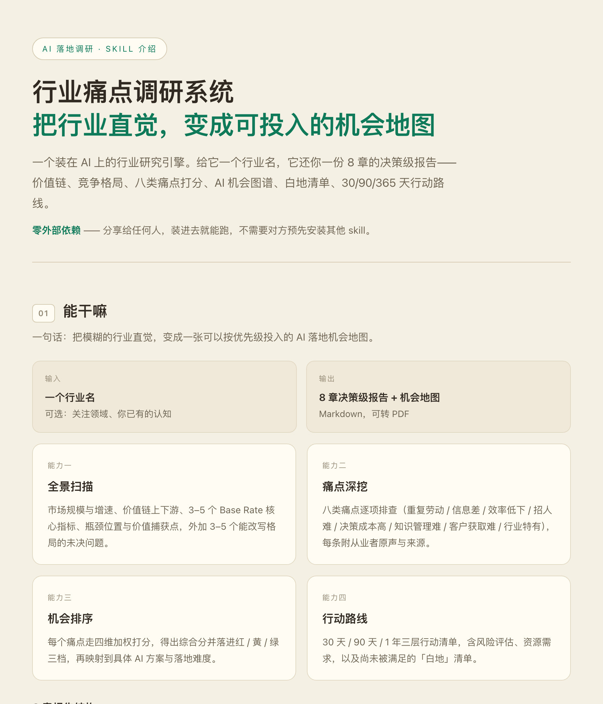

# Industry Painpoint Research · 行业痛点调研系统


> **One line**: Turn a vague industry hunch into a prioritized AI opportunity map.
>
> Give an AI agent an industry name. Get back a decision-grade report — sourced claims, scored pain points, and a 30/90/365-day action roadmap.

This is not "let AI search the web for industry info." That gives you *material*. This tells you *which one to do first*.

<p align="center">
  
</p>
<p align="center"><sub>👆 Full one-pager (1800×12731, Chinese): <a href="docs/preview-full.jpg">docs/preview-full.jpg</a></sub></p>

[简体中文](./README.md)

---

## Contents

- [At a glance](#at-a-glance)
- [Why it exists](#why-it-exists)
- [Before vs. after](#before-vs-after)
- [Quick start](#quick-start)
- [Example](#example)
- [Output structure](#output-structure)
- [How it works](#how-it-works)
- [Repo layout](#repo-layout)
- [Design principles](#design-principles)
- [When not to use it](#when-not-to-use-it)
- [Known limitations](#known-limitations)
- [FAQ](#faq)
- [Contributing](#contributing)
- [License](#license)

---

## At a glance

| | |
|---|---|
| **Input** | An industry name (+ optionally: focus area, what you already know) |
| **Output** | 8-chapter decision-grade report (Markdown, convertible to PDF) |
| **Runtime** | 3–40 minutes, three depth tiers |
| **External dependencies** | **None.** Clone and run |
| **Requires network** | Yes — sub-agents gather evidence via WebSearch / WebFetch |

**Four core capabilities**

1. **Landscape scan** — market size, value chain, base-rate metrics, bottlenecks and value-capture points
2. **Painpoint mining** — eight painpoint categories checked one by one, each with practitioner quotes and sources
3. **Opportunity ranking** — weighted four-dimension scoring → red / amber / green tiers → mapped to concrete AI solutions
4. **Action roadmap** — 30 / 90 / 365-day checklists + risk assessment + unserved "white space"

---

## Why it exists

Ask an AI to research an industry and you usually get one of four things. **The first two look perfectly fine.**

| Failure mode | Why it's dangerous |
|---|---|
| **Numbers that look real** | Figures, conclusions, clean formatting — and no sources. It never errors out. It's just quietly wrong. |
| **Correct but useless** | "Digital transformation is the defining trend." With no checklist, the model free-associates and returns the lowest common denominator. |
| **No idea what AI can actually do** | Piles of material, zero landing points. Reading it changes nothing. |
| **Breaks on unfamiliar industries** | When search comes up empty, the model starts inventing. **The less you know an industry, the more convincing the fabrication sounds.** |

This repo isn't about writing a better prompt. It's about **mechanisms that close off each of those four paths** (see [Design principles](#design-principles)).

---

## Before vs. after

| | Ask an AI directly | Use this skill |
|---|---|---|
| Output shape | A compendium; you finish reading and still don't know what to do | A ranked opportunity list + action roadmap |
| Trustworthy numbers | Numbers without sources; collapses under one follow-up question | Every claim carries a source; single-source claims are force-labeled *unverified* |
| Niche industries | Starts inventing when search fails | Says "insufficient data" and falls back to a minimum viable report |
| Landing points | "AI will profoundly reshape the industry" | Eight painpoint categories scored, resolved to "do this first" |
| Perspective | Single context; biases confirm themselves | Four sub-agents gather evidence in parallel, synthesized only at the end |
| Reproducibility | Structure drifts every session | Skeleton fixed in a template; stable output |
| Dependencies | Breaks when the environment changes | Zero external dependencies |

---

## Quick start

### 1. Install

```bash
git clone https://github.com/robertjim66/industry-painpoint-research.git
cp -r industry-painpoint-research ~/.workbuddy/skills/
```

> Skills directory on other platforms: `~/.claude/skills/` (Claude Code), `~/.codex/skills/` (Codex).
> This skill only uses WebSearch / WebFetch — no platform-specific capabilities required.

### 2. Start with one sentence

```
Research AI adoption opportunities in the <industry> sector
```

```
Find me the pain points in <industry>
```

### 3. Answer three questions

It will first confirm:

1. **Depth tier** — Quick scan / Standard / Deep due diligence
2. **Focus area** — the whole industry, or specific parts of the value chain
3. **What you already know** — if you have prior knowledge, don't let it start from zero

### Depth tiers

| Tier | Use when | Sub-agents | Output | Runtime |
|---|---|---|---|---|
| 🚀 Quick scan | Deciding whether it's worth going deeper | 2 | Executive summary + condensed painpoint matrix (800–1500 chars) | 3–5 min |
| 🔍 Standard | Regular decision support | 4 | All 8 chapters, condensed | 8–15 min |
| 🏗️ Deep diligence | Investment / strategy decisions | 4 + extra verification | 8 chapters + appendix + data tables | 20–40 min |

---

## Example

> 📁 [`examples/`](./examples/) holds four full samples: 5 copy-pasteable starter prompts, quick-scan output, the standard 8-chapter output, and — most instructive — **the degraded "minimum viable report"**.
> ⚠️ All output samples are structural illustrations, not real research. Do not cite them.

**Input**

```
Research AI adoption opportunities in third-party medical testing. Depth: standard.
```

**Output excerpt (structure illustration only — not real research results)**

<details>
<summary>Expand</summary>

```markdown
## 4. Painpoint Matrix (excerpt)

### Painpoint 3 · Low efficiency  🔴 High priority (composite 4.05)

- **Signals**: manual sample sorting, 3–5 day report turnaround, no cross-hospital data flow
- **Practitioner quote**:
  > "Two thousand tubes a day at peak. Sorting runs on people's memory. One mis-sort and the patient has to be re-drawn."
  > — practitioner post, industry community (source link)
- **Four-dimension score**:

| Dimension | Score | Basis |
|---|---|---|
| Pervasiveness | 5 | Present in both national and regional labs |
| Severity | 4 | Directly drives turnaround time and client retention |
| Willingness to pay | 4 | Labs already purchasing automated sorting lines |
| AI fit | 3 | Vision recognition is mature, but requires hardware integration |

> ⚠️ Willingness to pay is an **indirect inference** (basis: 12-month hiring volume for this role
> + public tender records). Not confirmed by primary interviews. Validate on-site before committing.

### 5. AI Opportunity Map (excerpt)

| High-priority painpoint | AI approach | Implementation difficulty | Prior art |
|---|---|---|---|
| Low efficiency | Vision-based sample sorting + exception recheck triggers | Medium (hardware integration) | 2 major labs have built in-house lines |
| Knowledge management | RAG Q&A over testing guidelines (for frontline physicians) | Low | No public cases → **white space** |
```

</details>

Full structure in [Output structure](#output-structure).

---

## Output structure

| Chapter | Contents |
|---|---|
| 1 · Executive summary | Key findings + 3–5 high-priority AI opportunities + data anchors + 30/90/365 roadmap |
| 2 · Industry landscape | Market size trend + value-chain map + base-rate metric cards + open questions |
| 3 · Player map | Four tiers (Direct / Adjacent / Aspirational / Substitutes) + 8-axis profiles + heatmap |
| 4 · Painpoint matrix | Eight categories + four-dimension scores + ranking + inter-painpoint analysis |
| 5 · AI opportunity map | Painpoint → AI solution mapping + difficulty + quantified upside + prior art |
| 6 · White space | Unmet AI needs + competitive gaps + barriers to entry |
| 7 · Strategic recommendations | 30 / 90 / 365-day actions + risk assessment + resource needs |
| 8 · Appendix | Every source link + methodology + verification log + limitations & disclaimer |

> The summary, landscape, and maps are the easy parts. **The appendix is where this skill's credibility lives** — without it, the first seven chapters are just pleasant reading.

---

## How it works

### Five stages

```
Scope → 4 sub-agents in parallel → Checkpoint 1 → Synthesis → Checkpoint 2 → 8-chapter report
```

The two human checkpoints are deliberate:

- **Checkpoint 1** (after the landscape): shift direction? — avoids wasting everything downstream
- **Checkpoint 2** (after the painpoint draft): anything to dig deeper? — avoids missing industry-specific painpoints

### Four sub-agents

| Sub-agent | Job | Primary evidence sources |
|---|---|---|
| `01-industry-scanner` | Size / value chain / base rates / bottlenecks | Industry white papers, public company filings |
| `02-competitive-analyst` | Four-tier classification / 8-axis profiles / structure | Company sites, trade press, funding data |
| `03-painpoint-hunter` | Eight painpoint categories + practitioner quotes | Job postings, forums, complaint boards |
| `04-ai-scout` | Existing AI solutions / feasibility / policy | Product pages, technical docs, policy texts |

Each has its own search queries and output schema. **Synthesis happens only in the main session** — a sub-agent never synthesizes its own conclusions.

### Scoring formula

```
Priority = Pervasiveness×0.30 + Severity×0.25 + WillingnessToPay×0.25 + AI-Fit×0.20
```

| Tier | Score | Action |
|---|---|---|
| 🔴 High | 3.5 – 5.0 | Act now; allocate resources first |
| 🟡 Medium | 2.0 – 3.5 | Put on the roadmap; start when conditions are right |
| 🟢 Low | < 2.0 | Keep watching; don't invest yet |

> **Willingness to pay carries 25% on purpose**: plenty of painpoints are real but nobody pays for them. Without scoring, they sort wrong.

---

## Repo layout

```
industry-painpoint-research/
├── README.md                      Chinese version
├── README_EN.md                   This file
├── CHANGELOG.md                   v1 → v3 design evolution
├── LICENSE                        MIT
├── .gitignore
├── SKILL.md                       Main flow: five stages + eight categories + scoring + fallbacks
├── agents/
│   ├── 01-industry-scanner.md     Industry scanner
│   ├── 02-competitive-analyst.md  Competitive analyst
│   ├── 03-painpoint-hunter.md     Painpoint hunter
│   └── 04-ai-scout.md             AI scout
├── references/
│   ├── bundled-methods.md         Bundled methods (why there are zero dependencies)
│   ├── report-template.md         8-chapter skeleton + depth-tier adaptation
│   ├── quality-checklist.md       14 quality checks + bias self-audit + style guide
│   └── sub-agents.md              Sub-agent task templates
├── examples/
│   ├── README.md                  Examples guide (read first: all illustrative)
│   ├── sample-input.md            5 copy-pasteable starter prompts
│   ├── sample-output-quick-scan.md   🚀 Quick scan output
│   ├── sample-output-standard.md     🔍 Standard 8-chapter output
│   └── sample-output-minimal.md      Degraded output: minimum viable report
└── docs/
    ├── preview-hero.jpg           Hero image embedded in this README
    └── preview-full.jpg           Full one-pager (1800×12731, Chinese)
```

**Minimum files to run**: `SKILL.md` + `agents/` + `references/bundled-methods.md`. The rest is optional.

---

## Design principles

These four are the difference between this and "a fairly well-written prompt."

**1. Taxonomy before research**
Eight categories are fixed up front: repetitive manual work / information asymmetry / low efficiency / talent scarcity / high cost of decision-making / knowledge management / customer acquisition / industry-specific (the eighth is dynamic, identified during the scan). Sub-agents **check items one by one** — they are not asked "so what do you think is wrong here?" A checklist makes it an audit; without one it's just an opinion.

**2. Anti-fabrication outranks completeness**
The 14-item quality checklist mandates: every claim carries a source link; single-source claims are labeled *unverified*; data older than two years is labeled *historical*; **counter-evidence must be actively searched for**; plus a six-type bias self-audit. The critical rule — **"insufficient data" is a valid answer**. Better a short report than a fabricated one.

**3. Parallel evidence defeats single-perspective bias**
Four sub-agents search independently and output independently; synthesis happens last. This prevents a single context from citing itself and reasoning a bias into a conclusion.

**4. The endpoint is a ranking, not a description**
The value isn't "now I understand this industry." It's "here's what I move on next week." Every finding must land on a score, a tier, and an action.

---

## When not to use it

- **You need validated market demand** — this produces hypotheses worth validating (see below)
- **You need primary user interviews** — it doesn't replace them; it narrows 20 candidate directions to the 3 worth interviewing about
- **The industry is extremely niche with near-zero public information** — fallbacks preserve honesty (no fabrication) but can't manufacture insight
- **You need real-time data** (stock prices, today's tenders) — it relies on public search and lags

---

## Known limitations

**This generates hypotheses. It does not validate demand.**

Everything comes from public sources: industry reports, filings, job postings, forums, complaint boards, policy documents. The painpoint hunter **infers** willingness to pay indirectly — a role appearing in job postings does not mean companies will pay for an AI solution to it.

So every inferred judgment in the report is explicitly labeled *indirect inference* or *unverified*. Treat the output as **"the shortlist worth a field visit"**, not validated demand.

Quality also tracks information density. The more public and more vocal an industry is, the better the output.

---

## FAQ

**Q: Can I hand the report straight to a client or my boss?**
Yes — but read chapter 8 first. Every source is there, and it's up to you to decide which figures to cite and which are flagged unverified.

**Q: Why is my report so short?**
Three possibilities: you picked 🚀 quick scan (summary + painpoint matrix only); a fallback triggered (minimum viable report when data is thin); **or the industry genuinely has little public information**. That last one is designed behavior, not a bug.

**Q: Can I customize the painpoint categories?**
Yes. The eighth category is dynamic and identified during the scan; you can also name additional categories at startup.

**Q: Does it work for non-Chinese / overseas industries?**
Yes. Search queries follow the industry name. Output is Chinese by default — say so at startup if you want English.

**Q: Can it run offline?**
No. All four sub-agents depend on web search. Offline you'll get a report that is almost entirely "insufficient data" — by design.

**Q: Why does SKILL.md keep insisting on using the current year?**
Search queries with hardcoded years **fail silently** — no error, no crash, just progressively staler results. Use the `[current year]` placeholder, or better, your search tool's date filter.

---

## Contributing

Issues and PRs welcome. The design evolution (why v1 became v3) is documented in [CHANGELOG.md](./CHANGELOG.md). Especially:

- **Real industry reports** — what you got (redacted) is the best test case
- **Painpoint categories** — which industries have a painpoint the eight categories miss?
- **Quality checks** — what fabrication patterns do the 14 checks still let through?
- **Search queries** — which query sets work better in your industry?

Before you PR: the core asset here is the anti-fabrication mechanism. Changes that **weaken source requirements, loosen the "insufficient data" rule, or introduce unsourced claims** will most likely not be merged.

---

## License

Code and docs: **MIT**

⚠️ Reports generated by this skill quote third-party data, industry research, and practitioner statements whose rights belong to their original authors. If you publish a report, confirm your citations are compliant.

---

<sub>If this saved you from one industry research project that wasn't worth doing, a Star helps ⭐</sub>
